# Project Overview

This project is a browser-based five-letter word guessing game. The player has up to six attempts to identify a hidden word, using feedback from each guess to make the next one. The intended purpose is to offer students and other puzzle players a short activity that exercises vocabulary, deduction, and problem-solving. The project began with a plan for five-, six-, and seven-letter modes, then narrowed to one five-letter game with accessibility for blind players as a design goal. The critical evaluation is in [evaluation.md](evaluation.md).

Project url: [https://ky25aaa-beep.github.io/SD-A1/](https://ky25aaa-beep.github.io/SD-A1/)
# Primary Target Audience

Ritchey et al. (2023) present four Wordle-based activities designed to help students develop mathematical concepts including combinatorics, probability, and strategy. LinkedIn launched Wend as its eighth game on 9 June 2026; it asks players to find hidden words by connecting letters in a grid, with each letter used once (Smith, 2026). These examples informed the choice to use a short word puzzle to engage vocabulary, deduction, and analytical thinking. The project targets students and academics interested in this kind of challenge, while prioritising access for blind players who use screen readers.

# Initial Game Idea

A five-letter Wordle-style guessing game.
# Initial Game, User, and System Requirements 
## Game Requirements 

**UI - User Interface**

Provide a colourised user interface consisting of 
6 rows containing five input boxes per row each initially a light grey colour

**Function - Program Behaviour**

Allow the user to interact with and complete only the current guess row

On word submission colourise the current row to match the states:

1. Letters in the guess that are not in the word should be dark grey 
2. Letters in the guess that are present in the word but in the incorrect position should be amber 
3. Letters present in the guess that are in the correct position should be green
4. The game after colourising should progress to the next line
5. The game should limit guesses to a total of six 
6. The game should limit guesses to only valid words

## User Persona

### Persona 1: blind student who uses a screen reader

**Name:** Alex (fictional persona)

**Context:** Alex is a student who enjoys short word puzzles and uses a screen reader and keyboard to use websites. Alex wants to play independently without needing visual feedback.

**Goals:**
- Enter a five-letter guess and move through the game using the keyboard.
- Understand which letters are correct, present in another position, or absent.
- Know how many guesses remain and whether the game has been won or lost.

**Needs and accessibility considerations:**
- Each letter input needs a clear label and position in the current guess.
- Game feedback must be available as text to assistive technology and must not depend on colour or an image alone.
- The game should announce guess results, validation errors, and the end of the game to the screen reader.
- Keyboard focus should follow the game flow and remain easy to control.

### Persona 2: student who enjoys word puzzles

**Name:** Jordan (fictional persona)

**Context:** Jordan is a student who likes short browser games and wants to practise vocabulary, deduction, and problem-solving between study tasks.

**Goals:**
- Understand the rules quickly and start a game without needing extra setup.
- Use clues from each guess to make a better next guess.
- Receive clear feedback and know when the game is complete.

**Needs:**
- Simple instructions and a clear, consistent game layout.
- Immediate feedback after each valid guess.
- A way to start a new game after finishing.

Accessibility requirements are informed by WCAG 2.2 guidance on keyboard access, input labels, use of colour, and status messages (W3C, 2024).

## User Requirements

- **UR1:** A blind player using a screen reader must be able to play the game using a keyboard, without needing a mouse.
- **UR2:** The player must be able to identify the current guess row and the position of each letter input.
- **UR3:** The player must be able to enter and submit a five-letter guess.
- **UR4:** After a valid guess, the player must be able to find out which letters are correct and in the correct position, present in the word but in another position, or absent from the word. This information must be available without relying on colour or images alone.
- **UR5:** The player must receive clear feedback if a guess is incomplete or invalid, and must be told when the game is won or lost and how many attempts remain.
- **UR6:** A player must be able to understand the rules quickly, receive feedback after a guess, and start a new game after finishing.

## System Requirements

### Functional requirements

- **FR1:** The game must present six guess rows, with five letter inputs in each row.
- **FR2:** The game must select a five-letter answer from its word list and accept guesses only in the active row.
- **FR3:** The game must require a complete five-letter guess and check that the guess is in the valid word list before evaluating it.
- **FR4:** The game must evaluate each letter as correct and in the correct position, present in the answer in another position, or absent from the answer. The evaluation must handle repeated letters consistently.
- **FR5:** After a valid guess, the game must show the result for each letter and advance to the next row when the answer has not been found.
- **FR6:** The game must end when the player finds the answer or uses all six guesses, and must communicate the outcome.
- **FR7:** The game must provide a way to start a new game.
- **FR8:** Guess results, validation messages, remaining attempts, and win/loss messages must be available to screen-reader users as text.

### Non-functional requirements

- **NFR1:** All game actions must be operable by keyboard, with a visible and predictable focus position.
- **NFR2:** Inputs and game status must have meaningful accessible names and text descriptions so screen-reader users can understand the game state.
- **NFR3:** Visual feedback must use text or distinguishable symbols as well as colour; colour or decorative images alone must not convey a result.
- **NFR4:** Instructions, feedback, and error messages must use clear and consistent language.
- **NFR5:** The browser-based game must use HTML5, CSS, and JavaScript and remain within the scope of one five-letter game.
- **NFR6:** If the word list cannot be loaded, the game must explain the problem and give the player a clear next step.

## Running the Prototype

Serve the `docs` directory as the website root so the game’s page links resolve correctly. From the project folder, run:

```powershell
cd docs
python -m http.server 8000
```

Then open `http://localhost:8000/` in a browser. The word list and jQuery are loaded from external URLs, so an internet connection is required for a first-time run.

## Current Implementation Choices and Trade-offs

- The page uses six rows of five single-character HTML inputs. The game script now assigns each input a row-and-position name and disables inactive rows.
- The page interaction is in `5-letter.js`, while `api/5-letter.js` handles word-list loading and guess evaluation. Keeping these responsibilities in separate files makes the roles easier to locate, though they share data through browser storage and global functions.
- The word list is fetched from the `darkermango/5-Letter-words` JSON endpoint and cached in `localStorage`. This avoids bundling the full list with the page, but a first-time player needs a network connection and the loading failure needs clear on-page feedback. The page also loads jQuery 3.6.0 from a CDN for input focus and message handling, creating another network dependency.
- The five-letter page uses colour classes for visual results. The game script now also stores each letter position status, adds it to the input accessible name, and announces guess feedback through a live status region.
- A reset control clears stored game values and reloads the page. The test plan includes checking that it starts a genuinely fresh game.

## Technical Problem: Repeated-Letter Feedback

During source review, repeated letters could be displayed with the wrong status. The evaluator calculated a status for each position, but the display layer relied on lists of letter values. If a guess contained the same letter more times than the answer, each occurrence could inherit the same “present elsewhere” style.

Two approaches were considered: calculate the position statuses again in the display layer, or save the evaluator’s five per-position statuses and let the display use those results. The second approach was selected so visual feedback and screen-reader feedback use the same result for each box. The evaluator now stores a five-item status array, and the page applies that status to each corresponding input.

An algorithm check using answer `apple` and guess `allee` returned `known, unknown, absent, absent, known`, correctly treating the extra `l` as absent. This check and JavaScript syntax checks passed.
### Browser check: input placeholder animation

In colour mode, a browser interaction check found that the previous flashing effect wrote underscore characters into empty input values. This could make an incomplete row appear complete to the guess-length check and expose placeholder characters as entered text. The effect was removed so the inputs remain empty until the player types. After the change, submitting a partially filled row produced the “Missing letters” message, and a complete valid guess advanced normally.
## Additional Feature: Blind-Friendly Interaction

The project extends the core guessing game with a blind-friendly interaction design. Letter inputs receive row-and-position names, guess results are described in text, and a live status region announces feedback and remaining attempts. Keyboard submission and visible focus styling are also included. This is intended as the project’s additional feature beyond the basic word-guessing loop.
## Design Evidence

### Proposed interface sketch

```text
Five-Letter Word Game
Instructions: Enter one letter in each box. Press Enter to submit a complete guess.
Status: Guess 1 of 6. [Screen-reader announcement area]

Guess 1: [ _ ] [ _ ] [ _ ] [ _ ] [ _ ]
Guess 2: [ _ ] [ _ ] [ _ ] [ _ ] [ _ ]
Guess 3: [ _ ] [ _ ] [ _ ] [ _ ] [ _ ]
Guess 4: [ _ ] [ _ ] [ _ ] [ _ ] [ _ ]
Guess 5: [ _ ] [ _ ] [ _ ] [ _ ] [ _ ]
Guess 6: [ _ ] [ _ ] [ _ ] [ _ ] [ _ ]

Feedback: Each letter's result is available as text and a visual cue.
[Start a new game]
```

### Pseudocode for a guess

```text
START a new game
Load the valid five-letter word list
IF the word list cannot be loaded
    explain the problem to the player
    stop until the list is available
SELECT a hidden answer
SET the current attempt to 1

WHILE the game is active
    let the player enter a guess in the current row
    IF the guess has fewer than five letters
        announce that all five letters are required
        keep the current row active
    ELSE IF the guess is not in the valid word list
        announce that the word is invalid
        keep the current row active
    ELSE
        mark exact letter-and-position matches first
        compare remaining letters with the remaining answer letters
        report each letter as correct, present elsewhere, or absent
        announce the feedback and attempts remaining
        IF every letter is correct
            announce a win
            end the game
        ELSE IF the current attempt is the sixth
            announce a loss and reveal the answer
            end the game
        ELSE
            move to the next row
            increase the attempt number
        END IF
    END IF
END WHILE

WHEN the player starts a new game
    clear the previous guesses and feedback
    select a new hidden answer
    return to the first row
```

### Game flow

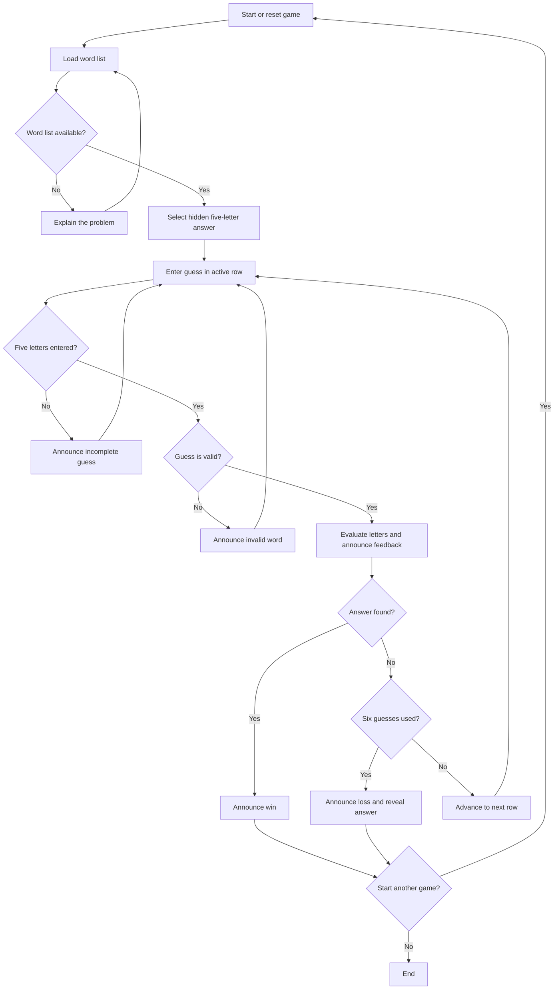

## Test Plan

The cases below come from the requirements. T0–T6 and T9 have been checked using syntax checks, an isolated algorithm check, and browser interaction checks. T7 was reported successful by the developer; its screenshot evidence is linked below. T8 has not been run.

| ID | Feature or scenario | Expected result | Actual result / status |
|---|---|---|---|
| T0 | JavaScript syntax | Both changed JavaScript files parse without syntax errors. | PASS: `node --check` for `5-letter.js` and `api/5-letter.js`. |
| T1 | Enter a complete valid five-letter guess | The game evaluates all five positions, announces the result, and advances when the answer is not found. | PASS: browser interaction check with `crane`; the page announced five position results, said 5 guesses remained, and enabled Guess 2. |
| T2 | Submit fewer than five letters | The game explains that the guess is incomplete and keeps the current row active. | PASS: browser interaction check with one letter entered; the page announced “Missing letters” and returned focus to the current row. |
| T3 | Submit a five-letter string absent from the valid word list | The game identifies the guess as invalid and does not consume an attempt. | PASS: browser interaction check with `xxxxx`; the page announced “Invalid word,” cleared the row, and kept Guess 2 active. |
| T4 | Guess `allee` when the answer is `apple` | Exact matches are handled first; the extra `l` is absent after the answer's only `l` has been matched. | PASS, algorithm check: `known, unknown, absent, absent, known`. |
| T5 | Guess the hidden answer | The game announces a win and prevents further guesses in that game. | PASS: browser interaction check; after `crane`, submitting the revealed test answer `ethos` announced “You win” and disabled the rows. |
| T6 | Use six valid guesses without finding the answer | The game announces a loss, reveals the answer, and prevents another guess in that game. | PASS: browser interaction check with `crane`, `slate`, `brook`, `plant`, `brick`, and `flame`; after guess six the game announced “Game Over” and revealed the answer. |
| T7 | Play using a keyboard and screen reader | Inputs and game feedback are understandable without relying on colour or images alone. | PASS — reported by the developer. Screen-reader use worked in the tested session. Screenshot evidence: [screen-reader test](EVIDENCE_IMG/07-accessible-screenreader-test.png). |
| T8 | Make the word list unavailable | The game explains that the list could not be loaded and gives a clear next step without starting an unusable game. | Not run |
| T9 | Start a new game after a completed game | Previous guesses and feedback are cleared, and a new game begins at the first row. | PASS in colour mode. FAIL in accessible mode: the reset board contains underscore or space values. See EVIDENCE_IMG/05-accessible-T9-after-reset.png and 06-colour-T9-after-reset.png. |

## Main Feature Screenshots

The following screenshots show real application states. The answer was inspected through Chrome's developer tools for the winning games, then entered through the normal game controls. Source code and game results were not modified. Screenshots document visible behaviour; they do not establish what a screen reader announced.

### Homepage

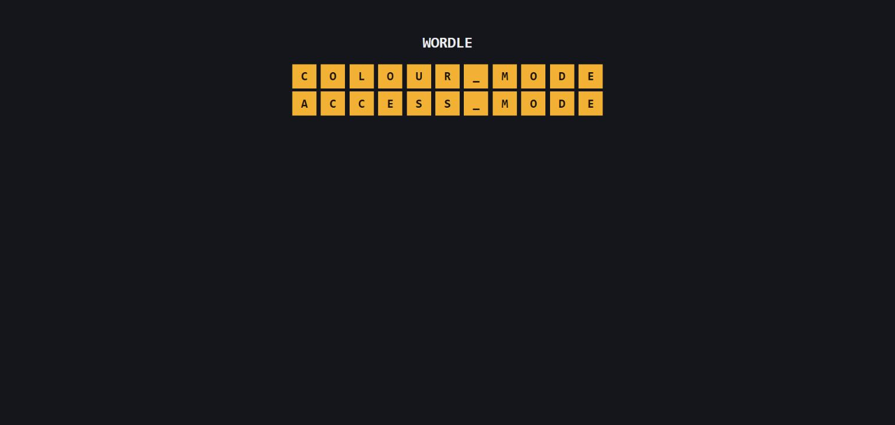

The homepage provides access to both game modes.

### Colour mode

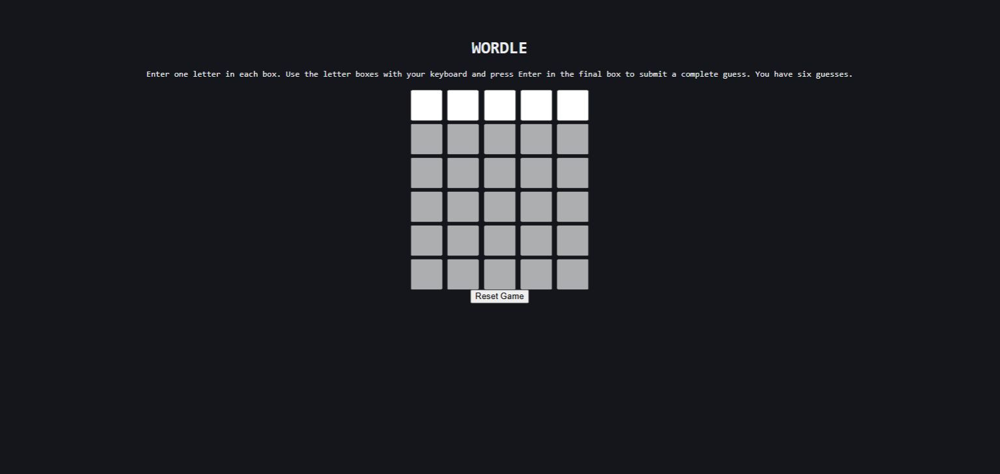

The board contains six rows of five inputs, with only the first row available for entry (FR1–FR2).

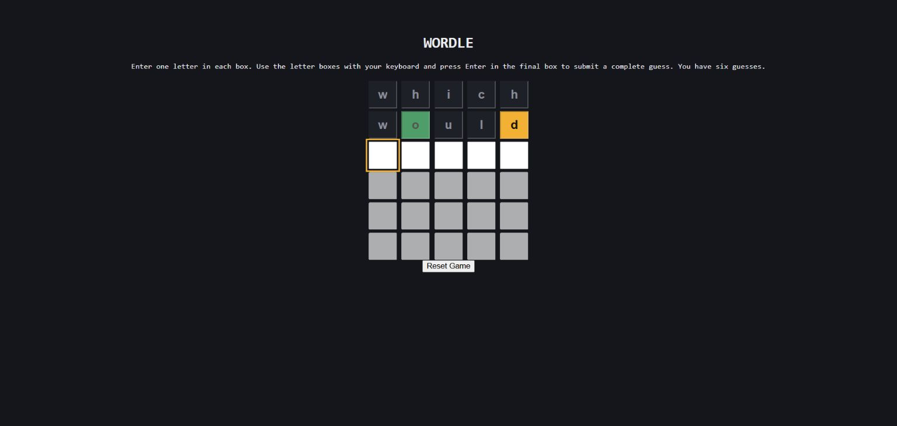

The guess `would`, against answer `dogma`, shows green for O in the correct position, amber for D in another position, and grey for absent letters (FR4–FR5).

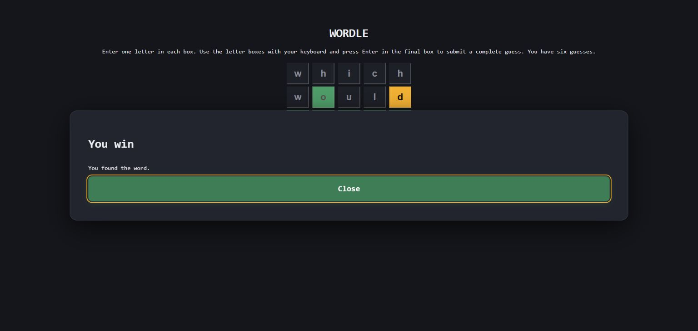

Entering `dogma` produces the winning message (FR6).

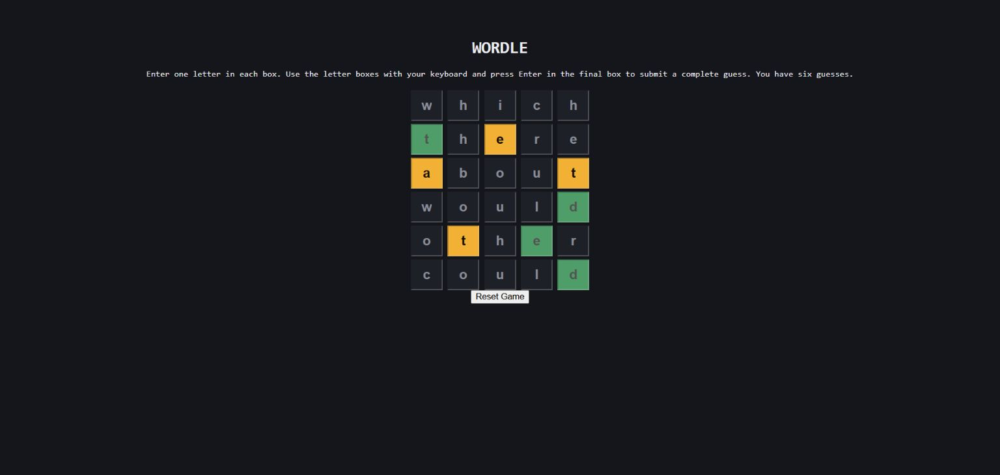

Six valid incorrect guesses complete the game. The result popup was dismissed to show all six rows and their feedback (FR6).

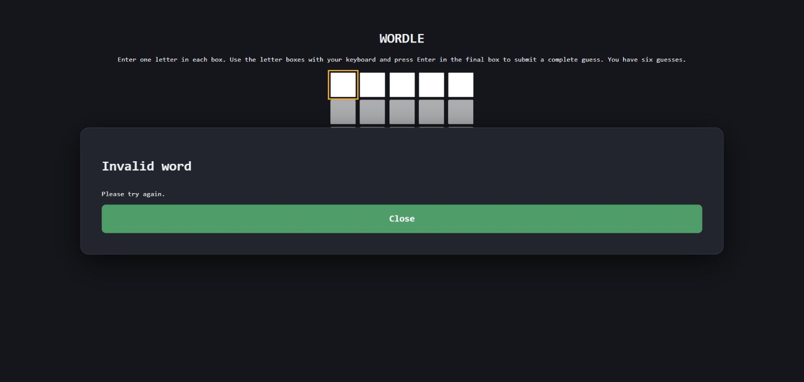

Submitting `zzzzz` produces an invalid-word message and keeps the current attempt available (FR3).

### Accessible mode

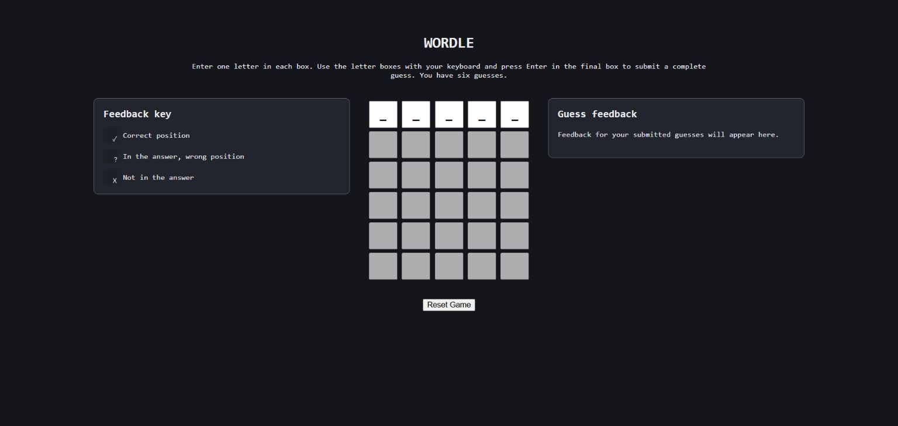

The interface includes a symbol key and a written feedback panel alongside the six-row board.

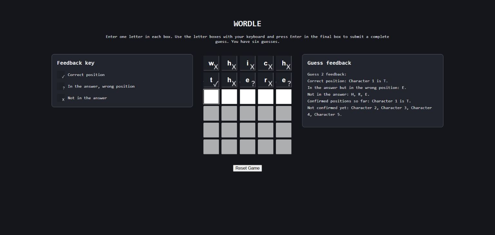

Symbols distinguish letter results, while the feedback panel describes correct positions, misplaced letters and absent letters (UR4).

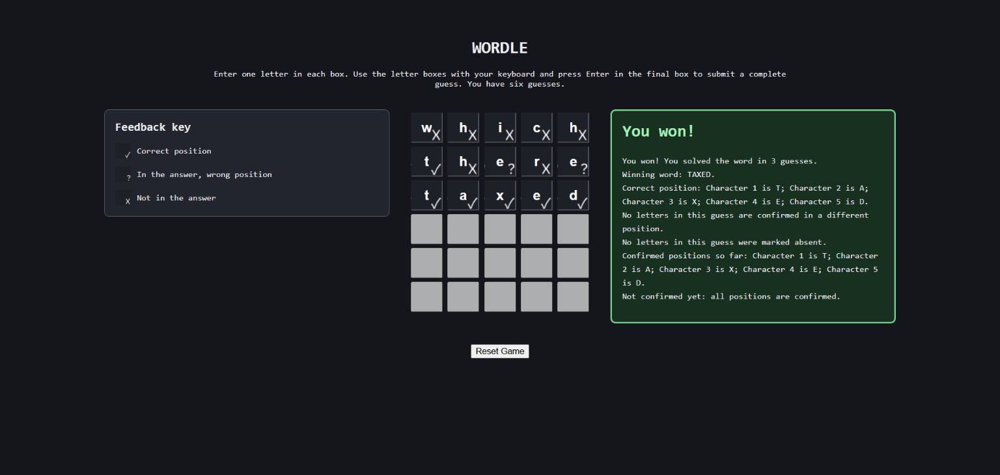

The feedback panel confirms the win in three guesses and identifies the winning word, TAXED (FR6).

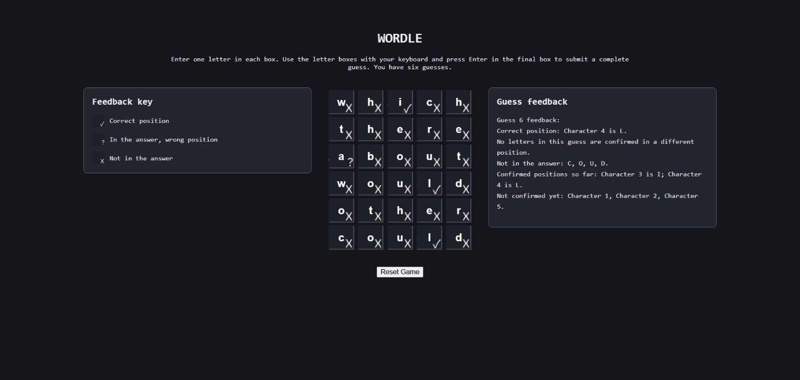

All six incorrect guesses and the final written guess feedback remain visible after the Game Over popup is dismissed (FR6).

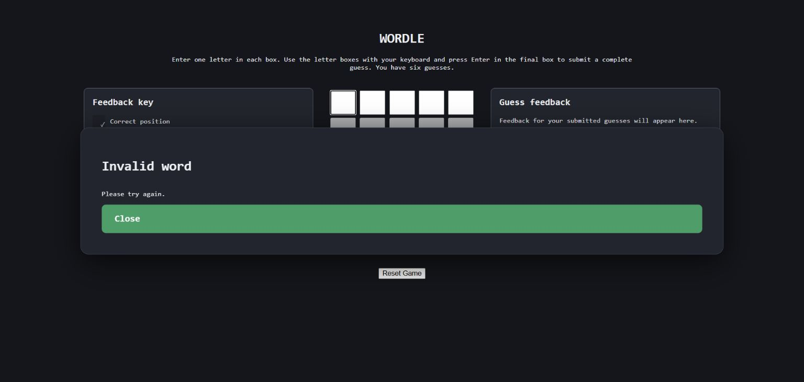

An invalid five-letter word produces an error message without advancing to the next attempt (FR3).

## Testing Results for Both Modes

These browser interaction checks supplement the test plan above. The loss rounds used `which`, `there`, `about`, `would`, `other` and `could`.

| Test | Expected result | Colour mode actual result | Accessible mode actual result | Result |
|---|---|---|---|---|
| Initial board | Six rows of five inputs; first row active | Initial board displayed | Initial board, symbol key and feedback panel displayed | PASS |
| Valid guess | Evaluate the guess and advance | `would` showed green, amber and grey feedback | `there` showed symbols and written positional feedback | PASS |
| Invalid word | Reject the word without using an attempt | `zzzzz` produced Invalid word | `zzzzz` produced Invalid word | PASS |
| Win | Recognise the correct answer and end the game | `dogma` produced You win | `taxed` produced You won and the winning word | PASS |
| Six incorrect guesses | End the game and reveal the answer | Game Over revealed `taxed`; six completed rows remained visible | Game Over revealed `pails`; six completed rows remained visible | PASS |
| Reset | Clear the previous round and return to the first row | Reset returned to an empty board | Reset cleared the board and feedback panel | PASS |

## Errors, Fixes and Retesting

### Repeated-letter feedback

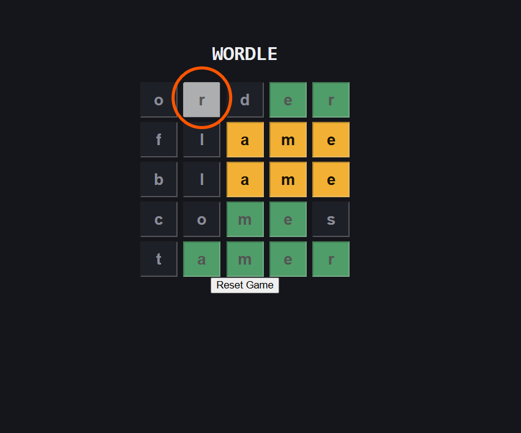

The earlier display could assign the same feedback to repeated occurrences of a letter. The fix stores and applies a separate status for each position, as explained in the technical problem section. The `apple` / `allee` algorithm retest returned `known, unknown, absent, absent, known`, so the extra L was marked absent.

### Input placeholder animation

The earlier flashing animation inserted underscores into input values, which could interfere with incomplete-guess validation. In colour mode, removing this effect left inputs empty until entry. A partially filled row then produced Missing letters, while a complete valid guess advanced normally. This fix is described in the browser check above and does not establish that the same animation was removed from accessible mode.

### Invalid Word Accepted as Guess
- [Invalid-word issue](README_IMG/SCREENSHOT-ERROR-INVWRD.png)

The original code did not have a function to test if the guess word was present in the master word list this meant users could guess "appln" and it be treated as a valid guess, this now produces an error as a function checks if guess is present in list wordlist.

### Incorrect Size png in Access Mode
- [Earlier no-colour layout](README_IMG/SCREENSHOT-ERROR-NO-COLOUR-UGLY.png)

The first iteration of Access Mode used boxes of size 16px by 16px this lead to an awful overlapping visual glitch instead on canva setting a box to the fixed dimension of the page fixed the issue. 
### Other recorded errors

- [Formatting issue](README_IMG/SCREENSHOT-ERROR-INC-FORMATTING.png)
- [Syntax or iteration issue](README_IMG/SCREENSHOT-ERROR-SYN-NO-ITERATION.png)

### Outstanding accessible-mode input issue

The placeholder animation remains in accessible mode. It inserts underscores or spaces into the inputs, and the recorded checks found that typing immediately after focusing a row could drop letters. Reset also returns to placeholder values rather than genuinely empty inputs. These issues remain unresolved; the colour-mode animation fix should not be treated as a fix for both modes.

- [Idle placeholder values](EVIDENCE_IMG/01-accessible-idle-placeholders.png)
- [Dropped letters](EVIDENCE_IMG/02-accessible-dropped-letters.png)
- [Colour-mode comparison](EVIDENCE_IMG/03-colour-same-typing-ok.png)
- [Accessible-mode reset](EVIDENCE_IMG/05-accessible-T9-after-reset.png)

## Development Approach and Risks

The project used prototyping to explore a Flask/API version before moving to client-side JavaScript for simpler GitHub Pages deployment. The scope was then reduced from three word lengths to one five-letter game with an accessible mode. The commit evidence and comparison of approaches are discussed in evaluation.md, section 3.

| Risk | Effect | Response or remaining limitation |
|---|---|---|
| Too much scope | Three word lengths could prevent completion of the core game | Reduced to five-letter play with an accessible mode |
| Hosting mismatch | GitHub Pages cannot run the Flask backend | Moved game logic to client-side JavaScript |
| External dependencies | Word-list or jQuery requests may fail | Word list is cached; first-load failure testing remains outstanding |
| Input and accessibility behaviour | Focus, placeholders or popup controls may interrupt play | Recorded issues in EVIDENCE_IMG; accessible-mode fixes and retests remain necessary |
| Late documentation and testing | Less time to explain decisions and resolve defects | Record this limitation in the evaluation and use earlier checkpoints in future work |

## Development Constraints

- **Initial plan (21 October 2026):** develop five-, six-, and seven-letter game versions.
- **Scope change:** implementing the five-letter guessing game proved more complex than expected. The project scope was reduced to one five-letter game, with an adaptation intended to make the experience more accessible to blind players, rather than completing all three word lengths.
- **Time:** the assignment estimates about 36 hours of work and has a submission date in the week commencing 26 October 2026.
- **Platform and technologies:** the application must be browser-based and use HTML5, CSS, and JavaScript. Other technologies require tutor approval.
- **Project requirements:** the work must be managed in a Git-based repository, include a deployed application, and implement at least one feature beyond the core game.


## Iteration Evidence

Iteration Evidence Can be found in the commit log at: [https://github.com/ky25aaa-beep/SD-A1](https://github.com/ky25aaa-beep/SD-A1)

## References and Credits

- darkermango (n.d.) *5-Letter-Words*. GitHub. Available at: https://github.com/darkermango/5-Letter-words (Accessed: 26 October 2026).
- OpenJS Foundation (n.d.) *jQuery Core 3.6.0*. Available at: https://code.jquery.com/jquery-3.6.0.min.js (Accessed: 26 October 2026).
- Ritchey, K., Patterson, S., Patterson, B. and Ritchey, N. (2023) ‘Wordle as a Teaching Tool’, *PRIMUS*, 33(8), pp. 901–915. doi: https://doi.org/10.1080/10511970.2023.2193951.
- Smith, H. (2026) ‘Introducing Wend: our eighth LinkedIn game’, *LinkedIn*, 9 June. Available at: https://www.linkedin.com/pulse/introducing-wend-our-eighth-linkedin-game-helen-smith-bpxec (Accessed: 26 October 2026).
- W3C (2024) *Web Content Accessibility Guidelines (WCAG) 2.2*. W3C Recommendation, 12 December. Available at: https://www.w3.org/TR/WCAG22/ (Accessed: 26 October 2026).

- Codecademy (2020) *Learn JavaScript with Codecademy!* [YouTube video], 13 April. Available at: https://www.youtube.com/watch?v=O8PlcR-4GRQ (Accessed: 26 October 2026).
- The accessible-mode tick, cross, question-mark and empty-square icons were created by me in Canva using Unicode symbols.
- JavaScript.info (2022) *Loops: while and for*. Available at: https://javascript.info/while-for (Accessed: 26 October 2026).
- JavaScript.info (2026) *Functions*. Available at: https://javascript.info/function-basics (Accessed: 26 October 2026).
- JavaScript.info (2025) *Async/await*. Available at: https://javascript.info/async-await (Accessed: 26 October 2026).
