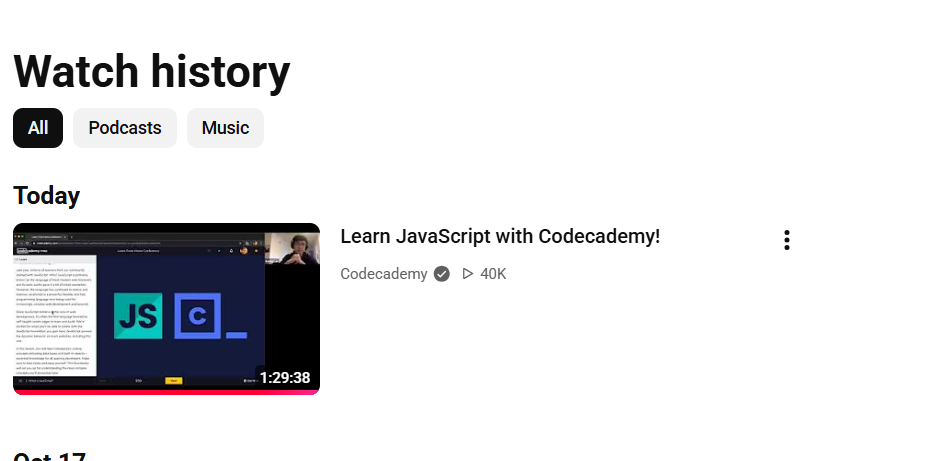

# Project Evaluation

## 1. Evaluation of the finished product

The project is a browser-based five-letter guessing game. It runs entirely in the browser without a game engine or server-side processing. Its main strength is its simplicity, it is just a word game with nothing else, no points, no rewards, no ads, just there to be mentally challenging. The player first enters a guess, receives per-letter clues, and can use those clues to decide what to try next. The original plan was for three distinct versions of the game five, six, and seven letter games. On 21 October 2026 the scope was reduced to one five-letter game because implementing the guessing version was more complex than expected. This gave the project a more achievable core and allowed the design to focus on access for visually impaired players.

The accessibility work adds labels to the letter inputs, keyboard submission, text descriptions of letter results, live status messages, and focus handling for messages. These choices address the needs of the visually impaired-player persona and reduce dependence on colour. However, the current checks do not establish that a visually impaired player can complete a game independently: keyboard and screen-reader testing is still required. The implementation should be evaluated with the test cases in the README and, if possible, feedback from a screen-reader user.

The game also depends on external services for jQuery and the word list. This reduces the amount of code and data bundled with the project, but makes startup depend on network access and those services remaining available.

### Success against requirements

| Area | Intended outcome | Current evidence | Evaluation |
|---|---|---|---|
| Core game | Six attempts, valid five-letter guesses, accurate clues, win/loss handling, and a new game | Browser tests T1–T6 and T9 pass in colour mode and T1–T6 pass in accessible mode (README test tables). Repeated-letter logic checked against 10,000 answer/guess pairs with 0 mismatches. Accessible-mode T9 fails: the "empty" board holds placeholder characters ([05](EVIDENCE_IMG/05-accessible-T9-after-reset.png)); colour mode resets cleanly ([06](EVIDENCE_IMG/06-colour-T9-after-reset.png)). | The core guessing loop works, but accessible-mode reset remains incomplete because placeholders are stored as input values. FR8 is not fully verified. Browser interaction checks are manual; the repeated-letter algorithm was checked separately. |
| Keyboard access | The player can use the game without a mouse and can see or identify focus | Typing advances focus and the fifth letter auto-submits. In accessible mode Enter on the Close control does not close the popup ([04](EVIDENCE_IMG/04-accessible-close-ignores-enter.png)); colour mode's button works. Typing straight after clicking into an accessible-mode row drops letters ([01](EVIDENCE_IMG/01-accessible-idle-placeholders.png), [02](EVIDENCE_IMG/02-accessible-dropped-letters.png)); colour mode is unaffected ([03](EVIDENCE_IMG/03-colour-same-typing-ok.png)). | T7 was attempted and identified problems. I observed unreliable Enter activation of Close; the recorded browser check also found that it did not close. Dropped letters in accessible mode prevent a full pass.|
| Screen-reader access | Inputs, clues, errors, remaining attempts, and final outcome are announced clearly | Labels and live regions are present in the source. Colour mode's popup has `role="alert"`; accessible mode's has no `role` or `aria-live`. Idle accessible-mode boxes contain `_` or a space ([01](EVIDENCE_IMG/01-accessible-idle-placeholders.png)). The developer reports a successful screen-reader test (T7). Screenshot evidence is referenced at [07](EVIDENCE_IMG/07-accessible-screenreader-test.png); the screen reader name, version and test date are not yet documented. | In my informal check, the right-hand guess feedback was read twice, and I paused the reader while entering a guess before resuming it. This identifies a limitation rather than confirming independent play. |
| Robustness | A missing word list is explained and the player can recover | The source now announces a word-list loading failure and gives a refresh instruction. T8 has not yet been run. | T8 was not run. Network failure can be tested on the hosted site by blocking the word-list request with the cached list cleared; recovery is therefore unverified. |
| Extra feature | At least one feature extends the core game | Accessible mode (`docs/play/no-colour/no-colour.html` and `no-colour.js`): symbol key, written feedback panel and per-input labels, shown in the README screenshots `README_IMG/TESTING/access-mode.png`, `access-guess.png` and `access-win.png`. | The symbols and written feedback are useful in Chrome on Windows, but the input and popup issues limit effectiveness. Other operating systems and mobile devices were not tested. |

## 2. Development process and decisions

The project scope changed from three word lengths to one five-letter game. The decision traded breadth for a more complete version of the main interaction and time to consider accessibility. 

A code issue was identified in repeated-letter feedback. The display previously depended on lists of letter values, which could give duplicate letters the same style even when only one matching answer letter remained. The chosen approach stores the evaluator's status for each of the five positions and uses those statuses in the display and accessible description. The check with answer `apple` and guess `allee` produced `known, unknown, absent, absent, known`; syntax checks for both changed JavaScript files passed. These checks establish the algorithm example and parse validity only. They do not demonstrate that the complete game or its assistive-technology behavior works.

The implementation separates page interaction (`5-letter.js`) from word-list and evaluation logic (`api/5-letter.js`). This makes responsibilities easier to locate, but the files still share state through browser storage and global functions. A later improvement could replace that shared state with a clearer interface between the game and evaluator, provided the change does not jeopardise the submission deadline.

### Reflection on the process

The most useful planning method was paper and pen, and then prototyping because it enabled the project to get working much quicker. However the better design decision would have been to start documenting and evidencing much sooner to enable the reflective, evaluative and the documentation part of this assignment to be written much faster. A decision I would make earlier next time is to start the GitHub project much sooner and begin documenting it because it meant I was lacking a lot of evidence of early development without css and other stuff.
- The hardest technical problem was colouring/indicating the individual character cells, especially if a letter was duplicated for instance a guess was "falls" the code would struggle to colourise the first l properly. I tried separating the known positions and unknown list and many different iterations like colourising sooner and later in the script inevitably the solution was to do a full wrap around of all the characters once all known positions were identified and then colourise known positions first, then unknown, and then absent.
- My time plan worked partly because while majority of the work was completed on schedule the code did not properly allow time for any mishaps and during the final week my vehicle was stolen and torched and therefore threw off my schedule completely. For Future Development projects I should allow a 20% follow through whereby I aim for 120% of the work needed to be completed by a date by that date and therefore should have a rolling lead of +20% above the minimum to do the project on time 

## 3. Comparison of development approaches

I used prototyping to find out what was practical before settling on the final design. My first version was a Python CLI and Flask application with an API. This became overly complicated for the project and required server-side hosting, which did not suit GitHub Pages. I therefore moved the game logic into client-side JavaScript. The final version still depends on external URLs for jQuery and the word list, so this change did not make it fully offline.

The commit history supports this development: [5dfa876](https://github.com/ky25aaa-beep/SD-A1/commit/5dfa876) records the Flask frontend on 23 September; [df1ca22](https://github.com/ky25aaa-beep/SD-A1/commit/df1ca22) records the move away from Flask on 30 September; [69bb42a](https://github.com/ky25aaa-beep/SD-A1/commit/69bb42a) continues the JavaScript transition on 7 October; and [df78ad4](https://github.com/ky25aaa-beep/SD-A1/commit/df78ad4) removes the Python requirements on 14 October. Later commits record the guide and deployment work. These commits evidence the changes, while the reasons for them are explained here.

Prototyping let me try the interaction and discover the hosting and complexity problems early. Its disadvantage was spending time on a version that was later replaced. Iterative development would organise repeated cycles of implementation, testing and improvement around a working version. I also used this process when refining validation and letter feedback; prototyping and iteration can overlap. More planned test cycles would have helped identify the remaining accessible-mode issues sooner.

A waterfall approach would set requirements and design before implementation, making the planned stages clearer. However, changes to the technology and game scope would have required revisiting those earlier stages. For an individual project with an estimated 36 hours, prototyping was suitable because it allowed the scope to be reduced from three word lengths to one five-letter game with an accessible mode. The limitation was that documentation and testing were left too late, so a future project needs clearer checkpoints alongside the prototypes.

## 4. Browser technologies and possible improvements

The project uses standard browser technologies: semantic HTML for the page, CSS for layout and visual states, JavaScript for game rules and interaction, browser storage for persisted values, and live regions and accessible names for assistive technology. These features allow a lightweight application without a server-side game engine. Their practical limits include browser differences in focus and input behavior, reliance on external resources, and the need to test the live-region behavior with actual assistive technologies.

A server-side alternative would keep answer selection and guess evaluation in Flask or PHP. This could keep the answer out of browser storage, but would require a server capable of running that application. The client-side version suited the chosen GitHub Pages deployment and reduced the hosting setup.

### Current and newer browser technologies

The current game uses established browser features: native HTML inputs and buttons, CSS styling, JavaScript event handling, and browser storage. These are a good fit for a small game because they work directly in the browser and keep the project simple. The page also uses accessible names and a live region to expose game state to assistive technology.

A newer option for reliability is a **service worker**. It could cache the page, styles, scripts, and a local copy of the word list, allowing the game to start when the player is offline. That would address the current remote word-list dependency, but it introduces cache updates and offline behavior that would need their own tests. Service workers require a secure context such as HTTPS in deployment; localhost is allowed for development ([MDN, Service Worker API](https://developer.mozilla.org/en-US/docs/Web/API/Service_Worker_API)).

Another option is **Web Components**, which could package a guess row and its inputs as a reusable custom element with its own behavior and styles. This could help if the project grew to multiple game modes, but for six identical rows it would add architecture and debugging work without a clear benefit yet ([MDN, Web Components](https://developer.mozilla.org/en-US/docs/Web/API/Web_components)).

For this version, native HTML controls and the existing JavaScript are the more proportionate choice. Service-worker caching is the most relevant future technology because it could reduce reliance on the network. Any change should be justified by the user need and verified with keyboard and screen-reader testing, rather than added only because the browser supports it.
Potential improvements include:

- Test with keyboard-only navigation and at least one screen-reader/browser pairing, then fix and retest problems found.
- Consider a single text input or a well-described composite input if testing shows that moving through five separate inputs is cumbersome.
- Provide a local fallback or bundled word list if the network failure test shows that the game cannot recover clearly.
- Add automated checks for repeated letters, accepted and rejected guesses, win/loss conditions, and reset behavior.
- Record browser and device details with the manual test evidence so results can be repeated.

These are recommendations for future work, not claims that the features are implemented.

## 5. Tools and design methods

GitHub provided version control and a history of changes, while GitHub Pages published the completed static application. These serve different purposes: commits document development, while Pages makes the game available to players. Renaming `demo` to `docs` allowed that folder to be selected as the publishing source. The history is useful evidence, although recording more design notes alongside each change would have made the decisions easier to explain later.

VS Code provided a local workspace for editing HTML, CSS and JavaScript. Chrome developer tools supported browser inspection and testing, including reading the stored answer before entering a winning guess normally. Unlike the editor, developer tools show the running application. A local server, `python -m http.server`, served the files during development; it did not run the game logic or replace deployment testing.

Paper sketches and the README interface sketch helped plan the layout quickly before detailed styling. Canva was used to adjust the symbol images to the dimensions required by the interface. These visual methods supported layout and appearance, rather than checking the game algorithm.

Pseudocode described the order of validation, letter evaluation and game-state decisions without depending on JavaScript syntax. The Mermaid flowchart showed the branches and loops visually, making the route from guessing to winning or losing easier to follow. A UML state diagram could have described the start, active, win and loss states more formally, but the existing flowchart was proportionate to this small game. Personas and requirement IDs connected these design choices to player needs and provided a basis for the test plan.

## 6. JavaScript course reflection and evidence

- **Course/platform:** freeCodeCamp Video
- **Modules completed:** Whole 3 hour video
- **Completion date:** 20-10-2026 to 26-10-2026
- **Evidence :** 

Reflect on the course in your own words: **[Which JavaScript ideas from the course did you use in the game? Give one concrete example from the source. What did you still need to learn independently?]**

## 7. References and credits

- darkermango (n.d.) *5-Letter-Words*. GitHub. Available at: https://github.com/darkermango/5-Letter-words (Accessed: 26 October 2026).
- MDN (n.d.) *Service Worker API*. Available at: https://developer.mozilla.org/en-US/docs/Web/API/Service_Worker_API (Accessed: 20 September 2026).
- MDN (n.d.) *Web Components*. Available at: https://developer.mozilla.org/en-US/docs/Web/API/Web_components (Accessed: 26 October 2026).
- OpenJS Foundation (n.d.) *jQuery Core 3.6.0*. Available at: https://code.jquery.com/jquery-3.6.0.min.js (Accessed: 14 October 2026).
- Ritchey, K., Patterson, S., Patterson, B. and Ritchey, N. (2023) ‘Wordle as a Teaching Tool’, *PRIMUS*, 33(8), pp. 901–915. doi: https://doi.org/10.1080/10511970.2023.2193951.
- Smith, H. (2026) ‘Introducing Wend: our eighth LinkedIn game’, *LinkedIn*, 9 June. Available at: https://www.linkedin.com/pulse/introducing-wend-our-eighth-linkedin-game-helen-smith-bpxec (Accessed: 21 October 2026).
- W3C (2024) *Web Content Accessibility Guidelines (WCAG) 2.2*. W3C Recommendation, 12 December. Available at: https://www.w3.org/TR/WCAG22/ (Accessed: 21 October 2026).

